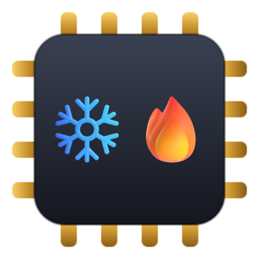
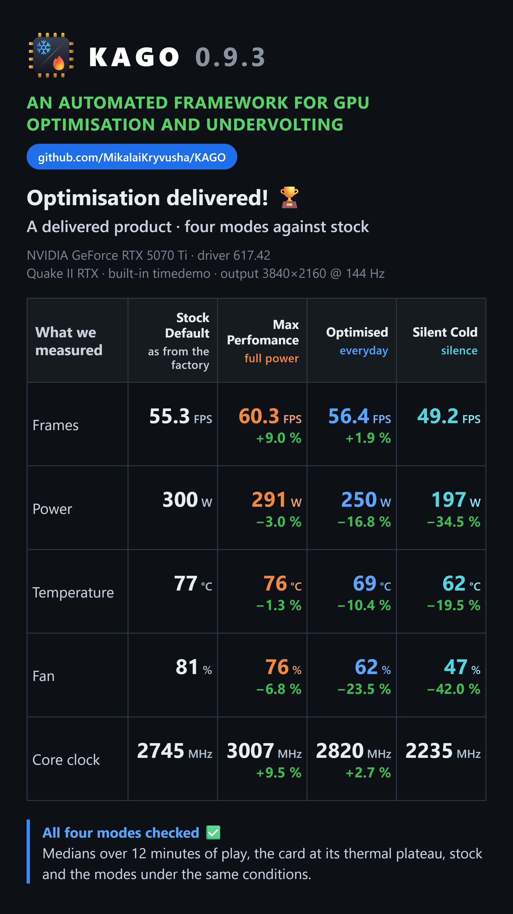
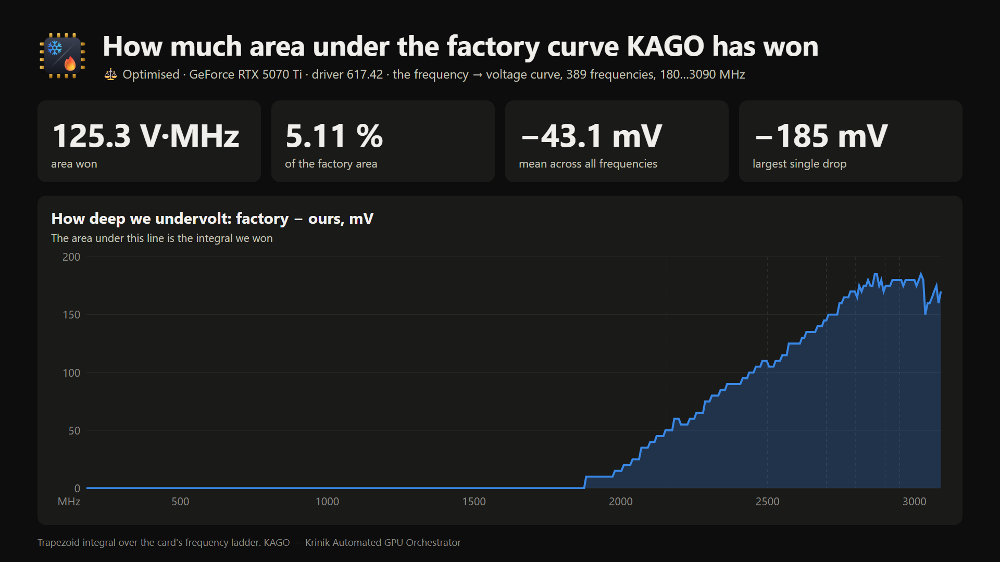
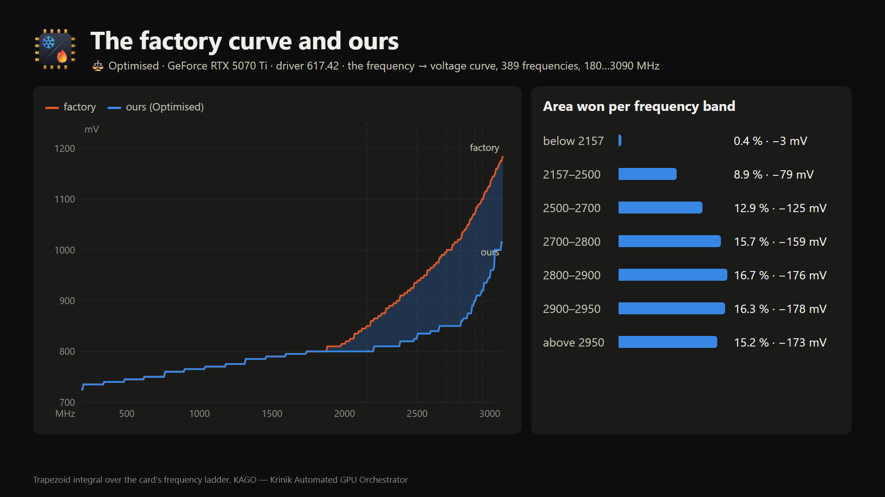
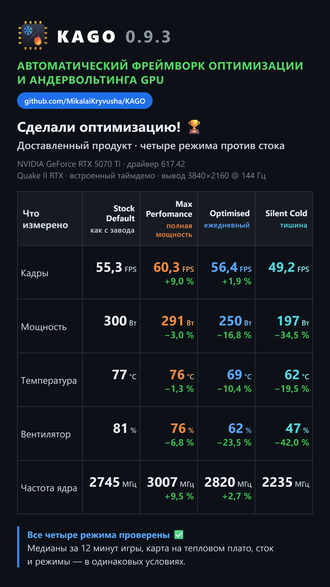
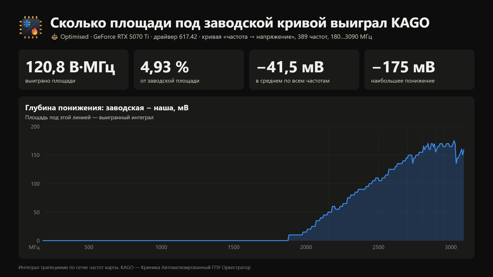
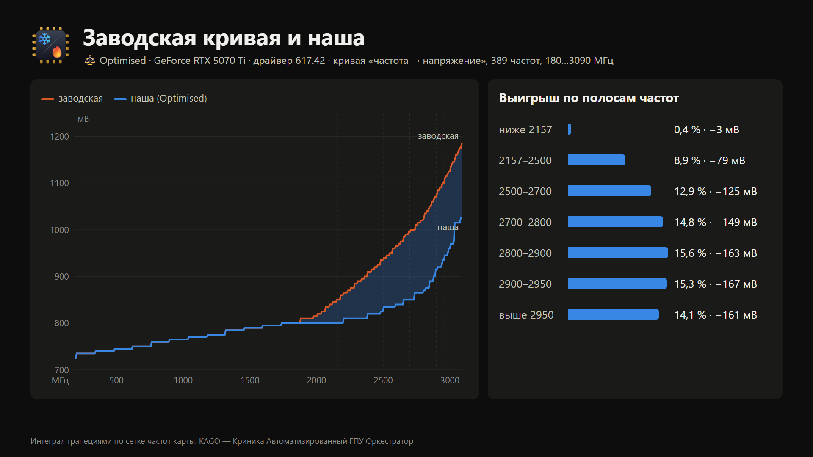

<a name="english"></a>

<p align="center">
  
</p>

<h2 align="center">KAGO</h2>

<p align="center">
  <a href="#english"></a>
  &nbsp;
  <a href="#russian"></a>
</p>

<p align="center"><b>Krinik Automated GPU Orchestrator</b><br>
Made by a gamer, for gamers. ❤️</p>

<p align="center">
  <a href="LICENSE"></a>
  <a href="#en-4"></a>
  <a href="#en-4"></a>
  <a href="#en-4"></a>
  <a href="#en-2"></a>
  <a href="https://github.com/MikalaiKryvusha/KAGO/releases/latest"></a>
  <a href="https://github.com/MikalaiKryvusha/KAIF"></a>
</p>

[Читать по-русски →](#russian)

**KAGO undervolts an NVIDIA graphics card on Windows. It builds the voltage curve for your particular chip, tests each
mode as a whole under a game and a stress burn, and puts four modes on desktop shortcuts — with no third-party GUI.**

An automated GPU optimisation tool. It gets the most out of your graphics card — extending its life and bringing quiet to
the room. It raises performance and lowers heat output. One click puts the card on a lower voltage; another click, or
simply a reboot, brings it back to the factory state.

<p align="center">
  
</p>

<p align="center">
  <a href="https://github.com/MikalaiKryvusha/KAGO/releases/latest"></a>
</p>

<p align="center">Windows 11, Node.js 18 or newer, administrator rights. Every version: <a href="https://github.com/MikalaiKryvusha/KAGO/releases">Releases</a>.</p>

Sections: [1 What it does](#en-1) · [2 The four modes and what they give](#en-2) · [3 How it works](#en-3) · [4 Install and first run](#en-4) · [5 Commands](#en-5) · [6 Project map](#en-6) · [7 Status and plans](#en-7) · [8 Author and licence](#en-8).

<a name="en-1"></a>
### 1. What it does

1. Builds a frequency → voltage curve for **this specific chip**. Silicon differs from card to card — between five cards of
   one model the lowest safe voltage varies by up to 70 mV — so KAGO ships the method, never someone else's numbers.
2. Tests a mode **as a whole**, not one frequency at a time: four minutes of a path-traced game, a stress burn at the power
   limit, sharp load steps, idle, and wake-ups from deep idle, while listening to the driver's own error channel.
3. Raises the margin exactly where the card failed: a failure is traced to its frequency band, and that band gets more
   voltage before the next test. Tuning narrows from the whole curve to a band, then to a single frequency.
4. Puts four modes on the desktop: 🚀 Max Perfomance, ⚖️ Optimised, ❄️ Silent Cold and 🔄 Stock Default. Every click
   ends in a verified state: the mode is applied and read back until two readings agree — or it is refused and nothing
   is written to the card.
5. Remembers the last mode you clicked and re-applies it at logon through the same checks. A tray icon shows which mode
   is live.
6. Keeps **the factory state as the default**: a mode lives in the card's volatile memory. A crash or a reboot brings the
   card back to stock, and you do nothing.
7. Never drives the card above its own maximum clock (this chip: 3090 MHz) and binds every mode to the driver and VBIOS
   it was proven on: after a driver update a mode will not apply until it is tested again.
8. Needs no MSI Afterburner and no other third-party GUI: the card is driven through the driver's own `nvidia-smi` and
   through KAGO's own NVAPI bridge, written in Node.js.

<a name="en-2"></a>
### 2. The four modes and what they give

All four modes stand on **one** voltage curve. A mode is that curve plus one setting: the power limit, and for Silent
Cold a frequency ceiling as well. None of them pins the clock — the card still boosts and still drops to idle speeds.

| Mode | What it is for | Power limit | Frequency ceiling |
|---|---|---|---|
| 🚀 **Max Perfomance** | everything into speed; the fans may spin as fast as they like | 300 W | the card's own maximum |
| ⚖️ **Optimised** | almost Max Perfomance frames, quieter and cooler | 250 W | the card's own maximum |
| ❄️ **Silent Cold** | the most frames that keep the fans at 40–50 % once the game settles | 250 W | about 2.2 GHz |
| 🔄 **Stock Default** | the factory card in one click: power limit, clocks and the whole curve | factory | — |

Measured against stock under the same load and in the same room:

| | 🔄 Stock | 🚀 Max Perfomance | ⚖️ Optimised | ❄️ Silent Cold |
|---|---|---|---|---|
| Frames, FPS | 55.3 | **60.3** (+9.0 %) | **56.4** (+1.9 %) | 49.2 |
| Power, W | 300 | 291 (−3.0 %) | **250** (−16.8 %) | **197** (−34.5 %) |
| GPU temperature, °C | 77 | 76 | **69** | **62** |
| Fan speed, % | 81 | 76 | **62** | **47** |
| Core clock, MHz | 2745 | 3007 | 2820 | 2235 |

<sub>GeForce RTX 5070 Ti, driver 617.42, 2026-10-17. Quake II RTX timedemo at 3840 × 2160, 60 passes per state —
about twelve minutes, until temperature and fans settle — with five minutes of idle between states.</sub>

<p align="center">
  
  
</p>

<a name="en-3"></a>
### 3. How it works

```
the curve:   the trend of the measured voltage edges of this chip  +  a margin per frequency band
               → an immutable snapshot, stamped with the driver it was built on
applying:    profile-manager — the only module that writes to the card
               → NVAPI curve offsets, computed from the card's live table at that moment
               → nvidia-smi power limit and a clock bound below the card's maximum
             read back until two readings agree, otherwise roll back to factory
testing:     game · burn · load steps · idle · wake-ups  →  telemetry sampler + the driver's error channel
               → verdict → a failure raises the margin of its band (a ratchet: it never goes back down)
```

1. **A model of the chip instead of a hunt for every edge.** The first method searched the voltage edge of each of the
   389 frequencies by crashing the machine at each one: six weeks gave 5 edges. All 14 edges measured so far lie on one
   line — `depth = −295.8 + 0.1674 · f`, scatter 4.9 mV — so the curve is that trend plus a margin per band, and the edge
   search is now used only to push further down.
2. **Frequencies, not table points.** The curve is stored as "frequency → voltage", which does not shift with
   temperature; the per-point offsets the hardware wants are computed at the moment of applying. That is also why the
   Silent Cold ceiling is "about 2.2 GHz": the curve caps it at 2205 MHz, and under the game the warm card runs at 2235.
3. **A failure is evidence, not the end of a run.** The test writes its intent to disk and `fsync`s it before the first
   byte reaches the card; a test the machine did not survive is closed on the next launch, at the band where the last
   telemetry sample was taken.
4. **Its own bench.** The Quake II RTX timedemo as the game load, KAGO's own CUDA burn that holds the card at its 300 W
   ceiling and moves terabytes through VRAM, a separate telemetry sampler, and a plateau detector — a comparison counts
   only once temperature and fans have settled. The tables and pictures on this page are drawn straight from the
   bench's records.

<a name="en-4"></a>
### 4. Install and first run

**What you need:** Windows 11, an NVIDIA GeForce card with a current driver, Node.js 18 or newer, administrator rights
(the driver refuses clock and power writes without them).

```powershell
git clone https://github.com/MikalaiKryvusha/KAGO.git
cd KAGO
npm run gpu:info                 # read-only: the card, driver, VBIOS, power range, clock ladder
npm run setup -- --install       # four desktop shortcuts, the apply tasks, the logon task and the tray
```

Everything `setup` creates outside the repository goes into a receipt **before** it is created, together with the
command that removes it. To remove everything, run `npm run setup -- --uninstall`.

> ⚠️ **The modes in `profiles/` are measured on the author's RTX 5070 Ti.** On another card or another driver they will
> not apply — that is the stamp check doing its job. For another card the method is the same, but its curve has to be
> measured and built for that chip; today that takes the edge probe and the curve builder
> (`node tools/curve-proposal.mjs`), not one button.

> **Undervolting changes how your hardware is powered.** Done carelessly it costs a frozen screen, a failed run, or
> corrupted output you do not notice for months. KAGO is built to make that unlikely and always reversible — and it is
> still your card. MIT means no warranty, and that clause is not decoration.

<a name="en-5"></a>
### 5. Commands

| Command | What it does |
|---|---|
| `npm run gpu:info` | reads the card: model, driver, VBIOS, power range, clocks, temperature |
| `npm run curve -- --progress` | how many modes have passed (of 4), the margin per band, the gain over stock |
| `npm run profile -- --apply <mode>` · `--reset` · `--state` | apply a mode · restore factory settings · read power and clock |
| `npm run validate -- --mode <mode> --candidate <profile> --minutes 4` | tests a whole mode — **writes to the card**, rolls back at the end |
| `npm run gfx -- --capture --label <name> --runs 60` | the game bench with telemetry, run until the card settles |
| `node automation-engine/lib/mode-validate.mjs --compare --stock <a> --mode <b>` | a mode's gain over stock, from two bench records |
| `node tools/curve-proposal.mjs` | builds the curve from the measured edges: the trend plus a margin per band |
| `npm run mon -- --seconds N --out <file>` | telemetry into a file, one sample every half second |
| `npm run check` · `npm run selftest:all` | pre-commit checks · all offline tests |

<a name="en-6"></a>
### 6. Project map

| Path | What lives there |
|---|---|
| `automation-engine/` | the orchestrator: the one module that writes to the card, the NVAPI bridge, mode testing, the bench, the shortcuts and the tray |
| `tools/` | operator tools: the curve builder and editor, the area integral, the infographics, the pre-commit checks |
| `profiles/` · `curves/` | the modes and the curve snapshots they stand on |
| `workloads/` | KAGO's own CUDA burn and its checksums |
| `assets/` | the logo, the icons, the infographics |
| `researches/` · `plans/` · `bugs/` | the research behind the decisions, the plans, one document per defect |

Where things are: [PROJECT_STRUCTURE_EXTERNAL_MAP.md](PROJECT_STRUCTURE_EXTERNAL_MAP.md); how they work:
[PROJECT_ARCHITECTURE_INTERNAL_MAP.md](PROJECT_ARCHITECTURE_INTERNAL_MAP.md).

<a name="en-7"></a>
### 7. Status and plans

0.9.3: **all four modes have passed a whole-mode test** on driver 617.42 and are compared against stock under the same
load. What remains is a week of everyday play: a failure during ordinary use goes into the test journal, raises its band,
and the mode is tested again. Next: going deeper band by band, a tray menu with `Exit`, and the lower frequency range. The
roadmap is [MASTER_PLAN.md](MASTER_PLAN.md), the current state is [STATUS.md](STATUS.md).

<a name="en-8"></a>
### 8. Author and licence

Author: **Mikalai Kryvusha aka KOT KRINIK** (Николай Кривуша, Кот Криник).
[GitHub](https://github.com/MikalaiKryvusha) · [Instagram](https://www.instagram.com/kotkrinik/) · [YouTube](https://www.youtube.com/@kotkrinik)

The project is **vibe-coded**: written together with an AI agent and run with [KAIF](https://github.com/MikalaiKryvusha/KAIF),
a framework for working with AI agents. Icons: [Fluent Emoji 3D](https://github.com/microsoft/fluentui-emoji) by Microsoft
(MIT). The game bench uses [Quake II RTX](https://github.com/NVIDIA/Q2RTX) by NVIDIA, installed separately.

KAGO is licensed under [MIT](LICENSE).

---

<a name="russian"></a>

<p align="center">
  
</p>

<h2 align="center">KAGO</h2>

<p align="center">
  <a href="#english"></a>
  &nbsp;
  <a href="#russian"></a>
</p>

<p align="center"><b>Криника Автоматизированный ГПУ Оркестратор</b><br>
Сделано геймером для геймеров. ❤️</p>

<p align="center">
  <a href="LICENSE"></a>
  <a href="#ru-4"></a>
  <a href="#ru-4"></a>
  <a href="#ru-4"></a>
  <a href="#ru-2"></a>
  <a href="https://github.com/MikalaiKryvusha/KAGO/releases/latest"></a>
  <a href="https://github.com/MikalaiKryvusha/KAIF"></a>
</p>

[Read in English →](#english)

**KAGO андервольтит видеокарту NVIDIA под Windows. Строит кривую напряжений под ваш конкретный кристалл, проверяет каждый
режим целиком — игрой и стресс-прожигом — и кладёт четыре режима ярлыками на рабочий стол. Без сторонних GUI.**

Автоматизированный инструмент оптимизации GPU. Выжимает максимум из вашей видеокарты — продлевая ей жизнь, даруя тишину
в комнате. Повышает производительность, снижает тепловыделение. Один клик — и карта работает на пониженном напряжении;
ещё один клик или просто перезагрузка — и она снова заводская.

<p align="center">
  
</p>

<p align="center">
  <a href="https://github.com/MikalaiKryvusha/KAGO/releases/latest"></a>
</p>

<p align="center">Windows 11, Node.js 18 и новее, права администратора. Все версии: <a href="https://github.com/MikalaiKryvusha/KAGO/releases">Releases</a>.</p>

Разделы: [1 Что умеет](#ru-1) · [2 Четыре режима и что они дают](#ru-2) · [3 Как устроено](#ru-3) · [4 Установка и первый запуск](#ru-4) · [5 Команды](#ru-5) · [6 Карта проекта](#ru-6) · [7 Состояние и планы](#ru-7) · [8 Автор и лицензия](#ru-8).

<a name="ru-1"></a>
### 1. Что умеет

1. Строит кривую «частота → напряжение» под **этот конкретный кристалл**. Кремний у каждой карты свой: у пяти карт одной
   модели самое низкое безопасное напряжение расходится до 70 мВ, поэтому KAGO отдаёт методику, а не чужие числа.
2. Проверяет режим **целиком**, а не по одной частоте: четыре минуты игры с трассировкой лучей, стресс-прожиг на пределе
   мощности, резкие скачки нагрузки, простой и пробуждения из глубокого простоя — и всё это время слушает собственный
   канал ошибок драйвера.
3. Поднимает запас ровно там, где карта сбоила: сбой приписывается своей полосе частот, и эта полоса получает больше
   напряжения до следующей проверки. Настройка сужается от всей кривой к полосе, а от полосы — к отдельной частоте.
4. Кладёт на рабочий стол четыре режима: 🚀 Max Perfomance, ⚖️ Optimised, ❄️ Silent Cold и 🔄 Stock Default. Каждый
   клик кончается проверенным состоянием: режим применён и перечитан, пока два чтения не совпадут, — либо отклонён, и в
   карту ничего не записано.
5. Запоминает последний режим и восстанавливает его при входе в систему через те же проверки. Иконка в трее показывает,
   какой режим сейчас включён.
6. Держит **заводское состояние по умолчанию**: режим живёт в энергозависимой памяти карты. Упала система или просто
   перезагрузились — карта снова стоковая, и делать ничего не надо.
7. Никогда не гонит карту выше её собственного максимума (у этого экземпляра 3090 МГц) и привязывает каждый режим к
   драйверу и VBIOS, на которых он проверен: после обновления драйвера режим не применяется, пока его не проверят заново.
8. Обходится без MSI Afterburner и других сторонних GUI: картой управляют штатная утилита драйвера `nvidia-smi` и
   собственный мост KAGO к NVAPI, написанный на Node.js.

<a name="ru-2"></a>
### 2. Четыре режима и что они дают

Все четыре режима стоят на **одной** кривой напряжений. Режим — это та самая кривая плюс одна настройка: лимит мощности, а
у Silent Cold ещё и потолок частоты. Ни один режим не фиксирует частоту — карта по-прежнему разгоняется и сбрасывается на
простое.

| Режим | Для чего | Лимит мощности | Потолок частоты |
|---|---|---|---|
| 🚀 **Max Perfomance** | всё в скорость; вентиляторы крутятся сколько угодно | 300 Вт | максимум самой карты |
| ⚖️ **Optimised** | кадры почти как у Max Perfomance, но тише и холоднее | 250 Вт | максимум самой карты |
| ❄️ **Silent Cold** | максимум кадров, при котором вентиляторы после прогрева держатся на 40…50 % | 250 Вт | около 2,2 ГГц |
| 🔄 **Stock Default** | заводская карта в один клик: мощность, частоты и вся кривая | заводской | — |

Замерено против стока под одной нагрузкой и в одной комнате:

| | 🔄 Сток | 🚀 Max Perfomance | ⚖️ Optimised | ❄️ Silent Cold |
|---|---|---|---|---|
| Кадры, FPS | 55,3 | **60,3** (+9,0 %) | **56,4** (+1,9 %) | 49,2 |
| Мощность, Вт | 300 | 291 (−3,0 %) | **250** (−16,8 %) | **197** (−34,5 %) |
| Температура GPU, °C | 77 | 76 | **69** | **62** |
| Обороты вентиляторов, % | 81 | 76 | **62** | **47** |
| Частота ядра, МГц | 2745 | 3007 | 2820 | 2235 |

<sub>GeForce RTX 5070 Ti, драйвер 617.42, 17.10.2026. Таймдемо Quake II RTX в 3840 × 2160, 60 проходов на состояние —
около двенадцати минут, пока температура и вентиляторы не выйдут на плато, — между состояниями пять минут простоя.</sub>

<p align="center">
  
  
</p>

<a name="ru-3"></a>
### 3. Как устроено

```
кривая:      тренд измеренных краёв напряжения этого кристалла  +  запас по полосам частот
               → неизменяемый снимок со штампом драйвера, на котором он построен
применение:  profile-manager — единственный модуль, который пишет в карту
               → сдвиги кривой через NVAPI, посчитанные по живой таблице карты в этот момент
               → лимит мощности и граница частоты ниже максимума карты через nvidia-smi
             перечитывание до совпадения двух чтений, иначе откат к заводскому
проверка:    игра · прожиг · скачки нагрузки · простой · пробуждения  →  сэмплер телеметрии + канал ошибок драйвера
               → вердикт → сбой поднимает запас своей полосы (храповик: назад не опускается)
```

1. **Модель кристалла вместо охоты за каждым краем.** Первый метод искал край напряжения каждой из 389 частот, доводя
   машину до сбоя на каждой: за шесть недель — 5 краёв. Все 14 измеренных краёв легли на одну прямую —
   `глубина = −295,8 + 0,1674 · f`, разброс 4,9 мВ, — поэтому кривая — это тренд плюс запас по полосам, а поиск края
   теперь нужен только для того, чтобы опуститься ещё ниже.
2. **Частоты, а не точки таблицы.** Кривая хранится как «частота → напряжение», а это от температуры не зависит; сдвиги,
   которые нужны железу, считаются в момент применения. Поэтому и потолок Silent Cold — «около 2,2 ГГц»: кривая
   ограничивает его на 2205 МГц, а под игрой прогретая карта работает на 2235.
3. **Сбой — это улика, а не конец прогона.** Проверка пишет намерение на диск и делает `fsync` до того, как первый байт
   уйдёт в карту; проверка, которую машина не пережила, закрывается при следующем запуске — в полосе, где снята последняя
   проба телеметрии.
4. **Свой стенд.** Таймдемо Quake II RTX как игровая нагрузка, собственный CUDA-прожиг, который держит карту на потолке
   300 Вт и прогоняет терабайты через видеопамять, отдельный сэмплер телеметрии и детектор плато: сравнение засчитывается,
   только когда температура и вентиляторы вышли на плато. Таблицы и картинки на этой странице нарисованы прямо из записей
   стенда.

<a name="ru-4"></a>
### 4. Установка и первый запуск

**Что нужно:** Windows 11, видеокарта NVIDIA GeForce со свежим драйвером, Node.js 18 и новее, права администратора (без
них драйвер не примет запись частот и мощности).

```powershell
git clone https://github.com/MikalaiKryvusha/KAGO.git
cd KAGO
npm run gpu:info                 # только чтение: карта, драйвер, VBIOS, диапазон мощности, лестница частот
npm run setup -- --install       # четыре ярлыка на рабочем столе, задачи применения, задача при входе и трей
```

Всё, что `setup` создаёт вне репозитория, записывается в квитанцию **до** создания — вместе с командой, которая это
удаляет. Чтобы убрать всё, запустите `npm run setup -- --uninstall`.

> ⚠️ **Режимы в `profiles/` замерены на RTX 5070 Ti автора.** На другой карте или другом драйвере они не применятся — так
> работает сверка штампа. Для другой карты методика та же, но кривую нужно замерить и построить под её кристалл; сегодня
> для этого нужны зонд края и построитель кривой (`node tools/curve-proposal.mjs`), а не одна кнопка.

> **Андервольтинг меняет то, как питается ваше железо.** Сделанный небрежно, он стоит зависшего экрана, сорванного
> прогона или испорченных данных, которых вы полгода не заметите. KAGO построен так, чтобы это было маловероятно и всегда
> обратимо, — и карта всё равно ваша. MIT означает отсутствие гарантий, и это не украшение текста.

<a name="ru-5"></a>
### 5. Команды

| Команда | Что делает |
|---|---|
| `npm run gpu:info` | читает карту: модель, драйвер, VBIOS, диапазон мощности, частоты, температуру |
| `npm run curve -- --progress` | сколько режимов прошло проверку (из 4), запас по полосам, выгода против стока |
| `npm run profile -- --apply <режим>` · `--reset` · `--state` | применить режим · вернуть заводские настройки · прочитать мощность и частоту |
| `npm run validate -- --mode <режим> --candidate <профиль> --minutes 4` | проверяет режим целиком — **пишет в карту**, в конце откатывает |
| `npm run gfx -- --capture --label <имя> --runs 60` | игровой стенд с телеметрией, до выхода карты на плато |
| `node automation-engine/lib/mode-validate.mjs --compare --stock <a> --mode <b>` | выгода режима против стока по двум записям стенда |
| `node tools/curve-proposal.mjs` | строит кривую по измеренным краям: тренд плюс запас по полосам |
| `npm run mon -- --seconds N --out <файл>` | телеметрия в файл, проба раз в полсекунды |
| `npm run check` · `npm run selftest:all` | проверки перед коммитом · все офлайн-тесты |

<a name="ru-6"></a>
### 6. Карта проекта

| Путь | Что там |
|---|---|
| `automation-engine/` | оркестратор: единственный модуль, который пишет в карту, мост к NVAPI, проверка режима, стенд, ярлыки и трей |
| `tools/` | инструменты оператора: построитель и редактор кривой, интеграл площади, инфографика, проверки перед коммитом |
| `profiles/` · `curves/` | режимы и снимки кривой, на которых они стоят |
| `workloads/` | собственный CUDA-прожиг KAGO и его контрольные суммы |
| `assets/` | логотип, иконки, инфографика |
| `researches/` · `plans/` · `bugs/` | исследования, на которых стоят решения, планы, по документу на каждый дефект |

Где что лежит: [PROJECT_STRUCTURE_EXTERNAL_MAP.md](PROJECT_STRUCTURE_EXTERNAL_MAP.md); как устроено:
[PROJECT_ARCHITECTURE_INTERNAL_MAP.md](PROJECT_ARCHITECTURE_INTERNAL_MAP.md).

<a name="ru-7"></a>
### 7. Состояние и планы

0.9.3: **все четыре режима прошли проверку целиком** на драйвере 617.42 и сравнены со стоком под одной нагрузкой. Осталась
неделя обычной игры: сбой в повседневном пользовании идёт в журнал проверок, поднимает свою полосу, и режим проверяется
заново. Дальше — углубление по полосам, меню трея с пунктом `Exit` и нижний диапазон частот. Дорожная карта —
[MASTER_PLAN.md](MASTER_PLAN.md), текущее состояние — [STATUS.md](STATUS.md).

<a name="ru-8"></a>
### 8. Автор и лицензия

Автор: **Mikalai Kryvusha aka KOT KRINIK** (Николай Кривуша, Кот Криник).
[GitHub](https://github.com/MikalaiKryvusha) · [Instagram](https://www.instagram.com/kotkrinik/) · [YouTube](https://www.youtube.com/@kotkrinik)

Проект — **вайбкод**: написан вместе с ИИ-агентом и ведётся по [KAIF](https://github.com/MikalaiKryvusha/KAIF),
фреймворку работы с ИИ-агентами. Иконки — [Fluent Emoji 3D](https://github.com/microsoft/fluentui-emoji) от Microsoft
(MIT). Игровой стенд использует [Quake II RTX](https://github.com/NVIDIA/Q2RTX) от NVIDIA, он ставится отдельно.

KAGO распространяется по лицензии [MIT](LICENSE).
