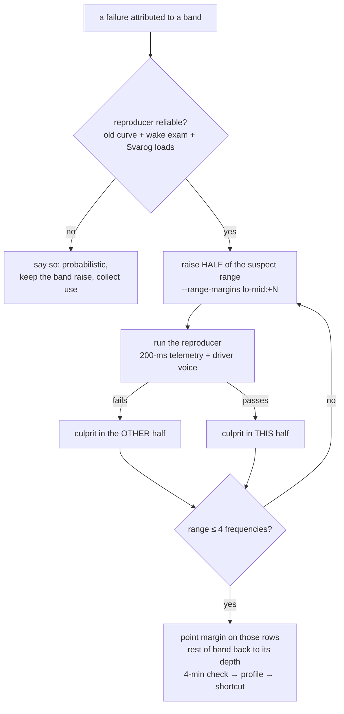

# Plan 106 — the frequency level by BISECTION: from a failing band to the failing frequencies

> **Created:** 2026-10-17 17:1x (session 109, on the owner's word) · **Parent:** `plans/101_EPIC…` (Ф2), `plans/105` (level 3) ·
> **Status:** 🔲 planned 2026-10-17; Ш1–Ш2 offline, Ш3 at the card with the owner · **Outbound:** — 

## Goal vector (Achieve)

**Pain:** a failure attributed to a BAND is cured today by raising the whole band (`bugs/148`: the top band −10 → +10 did not even
touch 3037…3075 MHz, where the GPU stalled; it raised 2962–2977 and 3082/3090 instead). The owner's order since 25.09 is precision
to the frequency (`ЗАКАЗ.md` §10: «нужна точность до частоты · Вся кривая -> полоса -> точка»), and the way from band to frequency
is named (`GOAL.md` → «🎯 ТОЧЕЧНО», 2026-10-17): **«Сначала ты крупные полосы поднимаешь, потом бисекция, и все ближе и ближе к тому,
чтобы точечно тюнить отдельные частоты»**.
**Where we want to be:** a failing band is narrowed by halving to the frequencies that fail; only they carry the raised margin, the
rest of the band keeps (or regains) its depth.

## Acceptance criteria

1. `npm run validate -- --step … --range-margins 3037-3075:+10` builds a curve where ONLY rows 3037…3075 carry +10 over their band
   and every other row equals the band curve — Check: `validate --selftest` block «ДИАПАЗОН…», a mutation (range ignored) reddens it.
2. The 16:45 failure (`bugs/148`, telemetry `runs/use/2026-10-17T16-42-56-optimised.jsonl`) is in the check journal as a failure
   with its points (3037…3075 at the snapshot `2026-10-17T15-36-44` voltages) — Check: `checkFailureFloors` lists them.
3. The top band of Optimised is bisected at the card to a set of ≤ 4 adjacent ladder frequencies that reproduce the failure, or the
   reproducer is shown unable to fail (then said, not guessed) — Check: the bisection log in `bugs/148`, each step with its curve,
   its run and its driver-voice count.

## Flowchart

## Steps

- [ ] **Ш1. Range margins in the builder** (offline): `curve-proposal.bandedCurve` takes `rangeMargins: [{ loMhz, hiMhz, mv }]`
  applied OVER the band margin for rows inside the range (a range is a sub-interval of the ladder, never crossing the card max);
  `validate --step --range-margins lo-hi:mv,…` passes them and names them in the document name; dry run prints them. Block + mutation.
- [ ] **Ш2. The observed failure enters the journal** (offline): a one-off record of the 16:45 failure as a check verdict
  (FAILED, `driver-voice`, `failureAt` = 3037…3075 from the recorded telemetry, rows of snapshot `2026-10-17T15-36-44`), marked
  `observedIn: 'use'` — the builder floors those rows (level 3, raise only).
- [ ] **Ш3. Bisection at the card** (the owner present, ~6 min a step, ≤ 5 steps for the ~18 top rows; 1–3 driver resets are the
  price): first the reproducer's reliability on the OLD curve (wake exam 2×60 s + 3 Svarog loads), then halves by Ш1.
- [ ] **Ш4. Close:** the found rows keep their margin, the rest of the top band back to −10 if it holds; 4-min check (with the wake
  stage) → profile → shortcut; `bugs/148` closed by the week of use.

## Risks

- (a) **The failure is probabilistic** (one reproduction in ~60 s): a passing half is weak evidence — each bisection step runs the
  reproducer at least twice; a «not reproduced» is said with the variants tried (TESTING_FRAMEWORK, the reproduction hunt).
- (b) 500-ms sampling hides the frequency between samples — 200-ms `nvidia-smi -lms` telemetry for every card step (it also
  survives the end-of-turn tidy, EXP-0307).
- (c) Driver resets on the owner's machine — only with him present; the card returns to factory by itself.

## Price (the owner's rule, interview 017 Q5)

Ш1–Ш2 ≈ one offline session; Ш3 ≈ 30 min of the card with the owner; moves the Optimised acceptance (`bugs/148`) and the
deepening of every band later (the same bisection serves 2800–2900 at −20).
