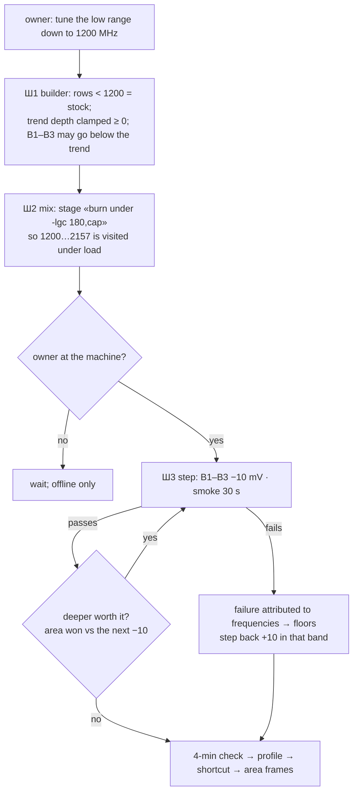

# Plan 107 — the low range: tune 1200…2157 MHz (and the bands up to 2700 below the trend), leave everything under 1200 at stock

> **Created:** 2026-10-17 18:1x (session 110, on the owner's word) · **Parent:** `plans/101_EPIC…` (Ф2 deepening), `plans/105`
> (level 2) · **Status:** ⏸ SHELVED 2026-10-17 18:1x by the owner («согласен» to the agent's honest estimate: 0,5–1,5 W, no noise or temperature gain — GOAL.md); Ш1 ✅ done (capability kept), Ш2–Ш3 not started · **Outbound:** —

## Goal vector (Achieve)

**Pain:** below ~1880 MHz our curve IS stock — 227 of 389 frequencies; the trend of 14 edges (all but one in 2745…3030) reaches
depth 0 at ~1770 MHz, and the agent's own rule (`config.NEGATIVE_MARGIN_FROM_MHZ = 2700`, `[AI]`) forbids going under the trend
below 2700. The owner, 17.10 (`GOAL.md` → «⬇️ НИЖНИЙ ДИАПАЗОН»): «а почему мы нижний диамазон не тюним дос их пор?» · «до 1200
можно тюнить» · «мегагерц».
**Where we want to be:** Optimised carries an undervolt on 1200…2157 MHz (and deeper than the trend on 2157…2700), proven by a
whole-mode check whose mix actually LOADS those frequencies; every frequency under 1200 MHz stays exactly at stock.

## Acceptance criteria

1. The builder never moves a row under `TUNE_FLOOR_MHZ` (1200) off stock, whatever the margins — Check: `proposal --selftest`
   block «НИЖЕ 1200 МГц — СТОК…», mutation (floor ignored) red.
2. A negative margin is accepted for B1…B3 and lands on 1200…2700 as «stock − trend-depth(≥ 0) + margin» — Check: block «НИЗ:
   ЗАПАС НИЖЕ ТРЕНДА…»; with today's margins (`0,0,0,−10,−10,−10,10`) the curve is `4215c7` byte for byte.
3. The check's mix visits 1200…2157 under load for ≥ `MIN_BAND_DWELL_S` — a stage «burn under a clock ceiling» (`-lgc 180,<cap>`,
   the bound, never a pin; restored to the profile's 180…3090 in the same stage's `finally`) — Check: `validate --selftest` block
   on the stage order + a live visit map showing B1 «посещена».
4. At the card: a descent of B1–B3 by −10 mV with 30-s smokes, closed by a 4-min check PASSED and the shortcut — Check: the run
   reports, `npm run curve -- --progress`, the area frames rebuilt (`node tools/build-area-card.mjs`).

## Flowchart

## Steps

- [x] **Ш1. Builder** (offline) — ✅ 2026-10-17 18:1x: blocks «НИЖЕ 1200 МГц — СТОК…», «НИЗ: ЗАПАС НИЖЕ ТРЕНДА…» (MLF1/MLF2 red on target); old-rule blocks rewritten; today's curve `4215c7` byte-identical; real dry run −10 in B1–B3 → `3c58c9` (area 5,68 %). Was: `config.TUNE_FLOOR_MHZ = 1200` (the owner's word, one home); `trendModel.rawAt` clamps the depth at
  ≥ 0 (a trend that predicts an OVERvolt below ~1770 MHz is meaningless — today min(stock) hides it, so the clamp changes no
  curve); `bandedCurve`: a row under the floor is stock; `negativeMarginAllowed` → «the band reaches above `TUNE_FLOOR_MHZ`»
  (B1…B7). Blocks + mutations; `4215c7` byte-identical for today's margins.
- [ ] **Ш2. Mix** (offline): a stage `burn-capped` — `profile-manager` sets the bound `-lgc 180,<cap>` (R1: the writer stays the
  one module), the furnace burn runs, `finally` restores the profile's bound; caps from the band boundaries (1500 for B1's upper
  half, 2100 for B1's top). Selftest on injected seams; the visit-map proof is the live check.
- [ ] **Ш3. At the card, the owner present:** B1–B3 −10 → smoke → … ; stop on the first failure or when the area gain per step
  falls under 1 V·MHz; 4-min check → profile → shortcut; rebuild the area frames; one line to KUMM on the mode change.

## Risks

- (a) **The one proven machine DEATH (08.09) came at idle after a write** (`researches/36`). Mitigated by construction: idle (P8,
  200…600 MHz) stays under 1200 MHz, i.e. on stock rows; the wake stage of the mix still runs.
- (b) Low frequencies draw 20…60 W: the watts won are small (≈ −5 % power per −20 mV at 1500 MHz); the area won is large (B1 is
  62 % of the stock area). Said to the owner with the price.
- (c) A clock bound left behind by a crashed stage keeps the card under the cap — the stage's `finally` restores it, and the
  check's rollback (`resetToFactory`) clears `-lgc` anyway (`-rgc`).

## Price (the owner's rule, interview 017 Q5)

Ш1–Ш2 ≈ one offline session; Ш3 ≈ 30–40 min at the card with the owner. Moves Ф3 (Max Perfomance, Silent Cold) by about one evening.
