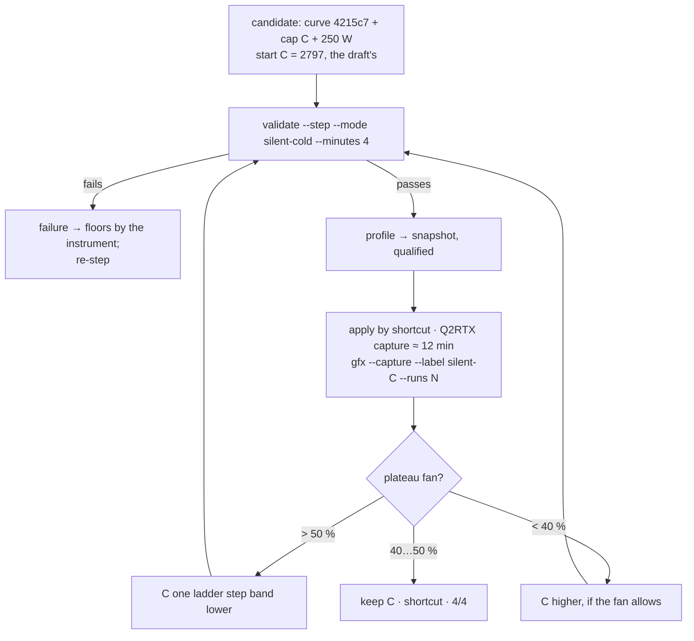

# Plan 108 — ❄️ Silent Cold: the frequency ceiling over the Optimised curve, chosen by the fan on the PLATEAU (40…50 %)

> **Created:** 2026-10-17 18:2x (session 110) · **Parent:** `plans/101_EPIC…` (Ф3) · **Status:** 🔲 planned; the card part with the
> owner · **Outbound:** —

## Goal vector (Achieve)

**Pain:** three modes of four are checked (17.10 18:13 — Max Perfomance). Silent Cold is the last; its profile is the 22.08 draft
(stamp 610.88, `curveRef: measured`, cap 2797, `qualified: false`).
**Where we want to be:** Silent Cold on the shortcut — the Optimised curve (`4215c7`, one curve for all modes, `ЗАКАЗ.md` §1),
250 W, a frequency ceiling at which the fan on the game PLATEAU sits at ≤ 50 %, preferably 40…50 % (`ЗАКАЗ.md` §1, the owner
25.09: «не более 50, желательно оказаться в диапазоне 40...50»), checked whole, «РЕЖИМОВ ПРОВЕРЕНО 4/4».

## Acceptance criteria

1. The candidate (curve `4215c7`, cap C, 250 W) passes the 4-min mode check — Check: `runs/validate/<moment>/report.md` «ПРОЙДЕНА».
2. On a Q2RTX capture long enough to plateau (the plateau comes at 395…753 s under the game — STATUS fact 34+36), the detector
   reports a plateau with the fan ≤ 50 % — Check: `node automation-engine/lib/thermal-ladder.mjs --analyze silent-<C>` prints
   «ПЛАТО» and the fan; 40…50 % is the target, < 40 % means the ceiling may go UP (performance left on the table).
3. `npm run curve -- --progress` prints «РЕЖИМОВ ПРОВЕРЕНО 4/4»; the ❄️ shortcut witnessed (offsets + 250 W, two reads).

## Flowchart

## Steps

- [ ] **Ш1. Check at the draft's cap 2797** (the owner present, under the KUMM lock): `npm run validate -- --step --mode silent-cold
  --band-margins 0,0,0,-10,-10,-10,10 --minutes 4` — the candidate inherits the profile's `curveCapMhz` (verify in the dry run that
  the cap lands in the candidate: `--dry-run` first).
- [ ] **Ш2. Qualify and apply**: profile → snapshot, stamp 617.42, `qualified: true` (the fan criterion is still open — the
  evidence says so), ❄️ shortcut, two reads.
- [ ] **Ш3. Fan plateau**: `npm run gfx -- --capture --label silent-2797 --profile silent-cold --runs <≈12 min>` → `thermal --analyze
  silent-2797`. Fan > 50 % → C lower and back to Ш1; < 40 % → C higher; 40…50 % → done.
- [ ] **Ш4. Close**: metric 4/4, area frames unchanged (the curve is the same), benefit table needs the stock 4-min check on 617.42.

## Risks

- (a) The 5-minute rule is for the MODE CHECK; the plateau capture is a measurement of ~12 min — named to the owner before it runs.
- (b) KUMM shares the machine: the capture holds the lock ~15 min — announce it, keep `until` honest.
- (c) A ceiling under ~2157 MHz cannot be held by the curve alone (internal map R11) — the clock bound `-lgc 180,C` holds it; the
  check's apply already sets the profile's bound (`graphicsClockLockMhz`), so C goes there as well as into `curveCapMhz`.

## Price (interview 017 Q5)

≈ 20 min of the card per ceiling tried (4-min check + ~12-min plateau), 1–3 ceilings → 20…60 min with the owner. Closes the project's
acceptance «4/4» (the week of use aside).
