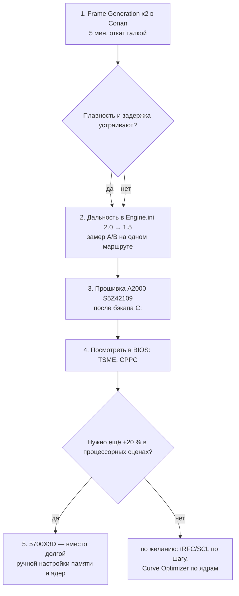

# Разведка 2026-11-09 — что ещё можно подкрутить в ПК ради игр (Conan Exiles и подобные)

> **Создан:** 2026-11-09 · **Режим:** только чтение — на машине ничего не менялось (ни BIOS, ни реестр,
> ни драйверы, ни службы). · **Для кого:** владелец, уровень «заказчик».
>
> **Метки в тексте:**
> **[ФАКТ]** — снято на этой машине сегодня командой;
> **[ИСТОЧНИК]** — цифра из чужого теста (ссылка рядом);
> **[ОЦЕНКА]** — мой вывод, на этой машине не мерялся. Прирост в играх у всех строк таблицы — оценка,
> пока его не замерили A/B в самой игре.

---

## 0. Главная поправка к исходным данным

**Conan Exiles на диске уже не на Unreal Engine 4.** В журнале игры:
`LogInit: Engine Version: 5.8.2-379176+++exiles+release` **[ФАКТ]** — это Conan Exiles **Enhanced на UE5**
(Lumen, Virtual Shadow Maps, Chaos, PSO-кэш SM6, IoStore). Поэтому советы под UE4 (и большинство старых
«engine.ini-твиков» с форумов) сюда не подходят. Игра поддерживает **DLSS Frame Generation и Reflex**
**[ФАКТ: ключи в GameUserSettings.ini; ИСТОЧНИК: tier1settings]**.

---

## 1. Что найдено на машине (локальная разведка)

| что | значение | вывод |
|---|---|---|
| **Где Conan** | `D:\Games\Conan Exiles 3.0.1\` — отдельная копия, не через Steam (в библиотеках Steam app 440900 нет) **[ФАКТ]** | Игра на **D: = NE-1TB, NVMe** — уже быстрый диск, переносить некуда |
| Ещё копии | `D:\Games\Conan Exiles (2018)`, `Conan_Exiles_3_0_1_clean_test`, `Conan Exiles Mods` **[ФАКТ]** | — |
| Моды | в журнале `LogModController ... MergeDataTables` **[ФАКТ]** | моды есть, могут добавлять нагрузку на процессор |
| Steam | `C:\Program Files (x86)\Steam` + библиотека `D:\SteamLibrary` **[ФАКТ]** | — |
| **HAGS** | `HwSchMode = 2` → **включено** **[ФАКТ]** | так и оставить — нужно для Frame Generation |
| Игровой режим | `AutoGameModeEnabled = 1` → **включён** **[ФАКТ]** | так и оставить |
| **VBS / HVCI** | `Win32_DeviceGuard`: VBS status 0, службы 0 → **выключено**; в журнале при каждой загрузке «VBS is disabled» **[ФАКТ]** | прирост от выключения уже получен (research 34) |
| Defender | защита в реальном времени **выключена целиком**; исключения есть, в т.ч. `D:\Games` **[ФАКТ]** | для игр тут выжимать нечего. Минус в безопасности — это осознанный выбор владельца |
| Файл подкачки | `D:\pagefile.sys`, фиксированный 22 ГБ, занято ~0,5 ГБ **[ФАКТ]** | на исправном NVMe, а не на сбоящем C: — хорошо |
| **Системный A2000 (C:)** | KINGSTON SA2000M8500G, **прошивка S5Z42105** **[ФАКТ]** | это **старая прошивка с известной ошибкой энергосбережения**; есть S5Z42109 (см. §3, строка 6) |
| Ошибки диска C: | за 30 дней: **17 × event 51** («ошибка при операции подкачки» на `Harddisk3` = A2000), **13 × stornvme 129** (сброс устройства), последний 08.11 **[ФАКТ]** | ошибки идут сразу после загрузки (через ~30 с после старта Windows), это знакомая картина для A2000 |
| Остальные диски | NE-1TB NVMe (D:) T0918A0L 53 °C; три SATA-SSD (F:, J:, E:) — здоровы **[ФАКТ]** | — |
| Драйвер NVMe | стандартный Microsoft `stornvme` 10.0.26100.9549 **[ФАКТ]** | норма, менять не нужно |
| **Шина видеокарты** | PCIe **Gen3 x16** (максимум 3, ширина 16x); в простое падает до Gen2 (это нормально) **[ФАКТ, nvidia-smi]** | потолок ставит процессор 5700G; Resizable BAR работает (BAR1 = 16 ГБ) |
| Драйвер NVIDIA | 621.01 **[ФАКТ]** | — |
| Встроенная графика 5700G | Windows её **не видит** (виден только её HDMI-звук); видимая память 32 560 из 32 768 МБ (резерв ~208 МБ — обычный резерв прошивки) **[ФАКТ]** | iGPU фактически выключен — с него больше ничего не вытащить |
| Схема питания | «Максимальная производительность», мин./макс. состояние процессора 100 % / 100 %, ASPM (PCIe) выкл. **[ФАКТ]** | уже выжато |
| Фон | NordVPN (520 МБ, заметное время ЦП), VS Code, службы Armoury Crate / ROG Live / AsusCert, ApolloService, SysMain, Windows Search, телеметрия **[ФАКТ]** | на кадры в секунду почти не влияет; VPN влияет на пинг до сервера |
| Виртуальные дисплеи | два: SudoMaker Virtual Display и Sunshine Virtual Display Driver **[ФАКТ]** | на FPS не влияет; просто дубль |
| События видеодрайвера | 96 × nvlddmkm 153, все 16–17.10 **[ФАКТ]** | относится к проекту андервольта видеокарты, сейчас тихо |
| **Engine.ini Conan** | уже правлен другим агентом (резервные копии q6…q8b). **Дальность прорисовки удвоена:** `r.ViewDistanceScale=2.0`, `foliage.LODDistanceScale=2.0`, `grass.CullDistanceScale=2.0`, `r.StaticMeshLODDistanceScale=0.75` **[ФАКТ]** | **это добавляет процессору работы** в игре, которая и так упирается в процессор (§3, строка 2) |
| Настройки Conan | `DLSSFrameGen=0` (выключено), `NvidiaReflex=1`, лимит 141 FPS, `sg.ViewDistanceQuality=4`, `sg.FoliageQuality=4`, `sg.ShadowQuality=4`; в файле стоит разрешение 1280×720 при оконном полноэкранном режиме **[ФАКТ]** | Frame Generation — самый большой неиспользованный рычаг |

> ✏️ **Поправка 2026-11-09 15:0x (сессия 115):** утверждение строки «Системный A2000» о «старой прошивке с известной ошибкой энергосбережения (APST)» НЕ подтвердилось: описание S5Z42109 в Kingston SSD Manager — только «drive unresponsive on Linux» и «compatibility with Asus Armoury Crate». Прошивка поставлена 09.11 15:05, активна после выключения 15:10 (STATUS).

---

## 2. Как читать таблицу

- **«Прирост в играх»** — для сцены, где упираемся в процессор (сейчас ~58 FPS, кадр процессора 15,3 мс).
  Там, где упираемся в видеокарту (4K без DLSS), строки про процессор и память дают почти ноль.
- **Риск**: низкий — откатывается одной галочкой; средний — возможны вылеты, нужна проверка стабильности;
  высокий — можно испортить данные или железо.
- Ранжировано по «польза ÷ (риск + время)» для Conan.

## 3. Рычаги — ранжированная таблица

| # | что | ожидаемый прирост в играх | риск | время | что уже сделано | источники |
|---|---|---|---|---|---|---|
| 1 | **DLSS Frame Generation в Conan** (×2; на RTX 50 есть и Multi Frame Gen ×3/×4). Промежуточные кадры рисует видеокарта, поэтому **процессорный потолок обходится** | **[ОЦЕНКА]** на экране ~58 → ~95–110 FPS при ×2. Отзывчивость не растёт, задержка ввода увеличивается на несколько мс (Reflex уже включён и частично это гасит). Лучше всего работает от ~60 базовых FPS | низкий (откат одной галкой); бывают артефакты на интерфейсе | 5 мин | выключено (`DLSSFrameGen=0`); HAGS для него уже включён | [tier1settings — Conan Enhanced](https://tier1settings.com/conan-exiles-low-fps-fix/), [Tom's — DLSS 3 лучше всего работает при низком FPS](https://www.tomshardware.com/news/dlss-3-early-review-rtx-4090), [TechSpot — DLSS 4 MFG, цена в мс](https://www.techspot.com/news/106265-early-dlss-4-test-showcases-cleaner-images-multiplied.html) |
| 2 | **Вернуть дальность прорисовки в Engine.ini** с 2.0 к 1.0–1.5 (`r.ViewDistanceScale`, `foliage.LODDistanceScale`, `grass.CullDistanceScale`) и `r.StaticMeshLODDistanceScale` с 0.75 к 1.0. Больше объектов и травы в кадре — больше вызовов отрисовки на процессорных потоках | **[ОЦЕНКА]** +5–15 % в процессорных сценах (база, лес). Под эту машину не мерялось — нужен замер A/B на одном маршруте | низкий (обмен на качество: дальние объекты появятся ближе) | 15 мин + замер | удвоено другим агентом (ради качества картинки) | [tier1settings — в больших базах упор в процессор, графика почти не помогает](https://tier1settings.com/conan-exiles-low-fps-fix/); механизм — общее знание об UE (ViewDistanceScale множит дальность отсечения) |
| 3 | **Апгрейд на Ryzen 7 5700X3D** (тот же сокет AM4, BIOS 3645 его поддерживает). 96 МБ L3 против 16 МБ + PCIe 4.0 для видеокарты и CPU-слота M.2 | **[ОЦЕНКА по цепочке источников]** в среднем +15–25 %, в «кэшелюбивых» процессорных сценах +25–35 %. Цепочка: 5700X ощутимо быстрее 5700G в играх (TPU); 5800X3D ≈ +15 % к 5800X в среднем, до +26 % в процессорных сценах (TechSpot); 5700X3D ≈ 91 % от 5800X3D (Tom's). Один агрегатор даёт для 5700G ≈ −34 % (HardwareDealz). **Прямого теста 5700G vs 5700X3D в UE5 я не нашёл** | низкий (замена процессора); теряется разгон +200 МГц, настройка памяти начинает значить меньше | 1 ч + деньги | — | [TPU 5700G](https://techpowerup.com/review/amd-ryzen-7-5700g/26.html), [TPU 5700X](https://techpowerup.com/review/amd-ryzen-7-5700x/single-page.html), [TechSpot 5800X3D vs 5800X](https://www.techspot.com/review/2451-ryzen-5800x3d-vs-ryzen-5800x/), [Tom's 5700X3D](https://www.tomshardware.com/pc-components/cpus/amd-ryzen-7-5700x3d-cpu-review), [GamersNexus 5700X3D](https://gamersnexus.net/cpus/new-amd-ryzen-7-5700x3d-cpu-review-benchmarks-vs-5800x3d-more), [HardwareDealz](https://www.hardwaredealz.com/produktvergleich/amd-ryzen-7-5700g-vs-amd-ryzen-7-5700x3d) |
| 3a | …в т.ч. **PCIe 3.0 → 4.0 для 5070 Ti** (доступно только сменой процессора) | **[ИСТОЧНИК]** на RTX 5090 Gen3 x16 теряет ~2–4 % против Gen5, Gen4 ~1 %; для 5070 Ti потери, скорее всего, меньше **[ОЦЕНКА]** | — | — | Gen3 x16, ReBAR включён **[ФАКТ]** | [TPU 5090 PCIe scaling](https://techpowerup.com/review/nvidia-geforce-rtx-5090-pci-express-scaling/33.html), [GamersNexus 5090 PCIe](https://gamersnexus.net/index%2ephp/gpus/nvidia-rtx-5090-pcie-50-vs-40-vs-30-x16-scaling-benchmarks) |
| 4 | **Ещё немного памяти:** по одному шагу и отдельно — tRFC 480 → ~420–440; SCL (tRDRDSCL/tWRWRSCL) 4/4 **отдельно** от остального «агрессивного» набора (в BSOD 0x133 он попал целым пакетом, поэтому виновник неизвестен); tWTRL 8 отдельно | **[ОЦЕНКА]** +1–3 % к процессорному кадру; разница на уровне погрешности замера (PCGH: шум 1–2 %) | средний (каждый шаг — полный TestMem5) | 2–4 ч на шаг | tRC/tRRD/tFAW/tWR/tRTP/tRFC уже подтянуты, 109 → 90 нс | [TPU — гайд по таймингам Ryzen (tRFC/tRP дают больше всего)](https://techpowerup.com/review/amd-ryzen-memory-tweaking-overclocking-guide/6.html), [PCGH — сабтайминги Ryzen 5000](https://www.pcgameshardware.de/RAM-Hardware-154108/Specials/Subtimings-von-DDR4-Ryzen-5000-optimieren-1404877/) |
| 5 | **Вторая попытка DDR4-3600 (FCLK 1800)** — не напряжением VDIMM (у планок обратная зависимость от напряжения), а терминацией для 4 одноранговых планок: ProcODT ~32–36,9 Ом, RttNom off / RttWr RZQ/3 / RttPark RZQ/1; VSOC ~1,10–1,15 В; VDDG ~0,95–1,0 В; tRFC свободнее. Или промежуточно 3400/3466 | **[ОЦЕНКА]** +3–6 % к процессорному кадру при успехе (на Zen 3 частота памяти в процессорных сценах помогает — Tom's). С 5700X3D выигрыш вдвое меньше | средний: долгая проверка; ошибка памяти может молча портить файлы | 4–8 ч | 3600 не прошла TestMem5 при 1,40 и 1,45 В | [TPU — ProcODT/Rtt для 4 одноранговых планок AM4](https://techpowerup.com/review/amd-ryzen-memory-tweaking-overclocking-guide/7.html), [Tom's — память Ryzen 5000](https://www.tomshardware.com/features/ryzen-5000-ram-guide), [Tom's — 4 ранга на DDR4-3600 — лучший практичный вариант](https://www.tomshardware.com/reviews/amd-ryzen-3000-best-memory-timings,6310-2.html), [SkatterBencher 5700G: FCLK 2133, VSOC 1,35 В на 2 планках](https://skatterbencher.com/2021/04/27/skatterbencher-24-amd-ryzen-7-5700g-overclocked-to-4850-mhz/) |
| 5a | **Проверить TSME в BIOS** (AMD CBS → шифрование памяти). На APU Renoir/Cezanne при включении добавляет ~5–10 нс задержки | **[ИСТОЧНИК — форум, не обзор]** если вдруг включено: ~−5–10 нс → +1–3 % **[ОЦЕНКА]**; если выключено — ноль | низкий | 5 мин (посмотреть) | не проверено (из Windows не читается) | [TPU forum — TSME на Cezanne](https://www.techpowerup.com/forums/goto/post?id=4816144) (страница отдала 403, цитата из выдачи поиска) |
| 6 | **Прошивка A2000 S5Z42105 → S5Z42109** через Kingston SSD Manager (сначала резервная копия C:) | **[ОЦЕНКА]** FPS не прибавит. Может убрать ошибки 51/129 на системном диске, а с ними — редкие подвисания (на C: лежат Windows, DLL и кэш шейдеров NVIDIA) | низкий–средний (прошивка системного диска) | 30 мин | ошибки есть с середины октября **[ФАКТ]** | [Kingston — список прошивок (A2000 S5Z42109 от 2021-03-30)](https://www.kingston.com/unitedkingdom/en/support/technical/ksm-firmware-update), [патч ядра Linux: A2000 падает в глубоком сне APST](https://lore.kernel.org/linux-nvme/20210129052442.310780-1-linux@leemhuis.info/), [basic-tutorials — S5Z42109 лечит энергосбережение](https://basic-tutorials.de/?p=177183) |
| 7 | **Curve Optimizer по ядрам** вместо −10 на все: лучшим ядрам (на них Windows сажает главный поток игры) — сколько выдержат, остальным — глубже (−15…−30 — обычное дело для Zen 3; у SkatterBencher на 5700G было −13…−30). Проверка — CoreCycler по одному ядру, часами | **[ОЦЕНКА]** +0–3 % в играх: на 1–2 лучших ядрах частота почти упирается в 4850, запаса мало | средний: нестабильность ловится не сразу (вылеты в простое или при лёгкой нагрузке) | 6–12 ч проверки | −10 на все ядра, +200 МГц, PBO **[ФАКТ из брифа]** | [CoreCycler (overclock.net)](https://www.overclock.net/threads/corecycler-tool-for-testing-single-core-stability-e-g-curve-optimizer-settings.1777398/), [HotHardware — CO на Zen 3](https://hothardware.com/reviews/amd-power-curve-optimizer-guide-zen-3), [SkatterBencher 5700G](https://skatterbencher.com/2021/04/27/skatterbencher-24-amd-ryzen-7-5700g-overclocked-to-4850-mhz/) |
| 8 | **Размер кэша шейдеров NVIDIA** → 100 ГБ или «без ограничения» | **[ОЦЕНКА]** FPS — ноль; меньше рывков после обновлений. Для DX12 спорно: UE5 ведёт собственный PSO-кэш (у Conan есть `upipelinecache`) | низкий | 2 мин | не проверено | [Epic — шейдерные рывки и PSO precaching](https://www.unrealengine.com/en-US/tech-blog/game-engines-and-shader-stuttering-unreal-engines-solution-to-the-problem), [Steam — спор, влияет ли на DX12](https://steamcommunity.com/discussions/forum/11/5406000785150410900/?l=turkish) |
| 9 | **Модов и объектов в базе меньше** (тралы, светильники, мебель) | **[ИСТОЧНИК]** в больших базах упор в процессор из-за объектов и ИИ тралов; это самый честный рычаг именно в Conan | нет | по вкусу | — | [tier1settings](https://tier1settings.com/conan-exiles-low-fps-fix/) |
| 10 | Службы ASUS (Armoury Crate, ROG Live), NordVPN во время игры | **[ОЦЕНКА]** FPS ~0; иногда меньше редких фризов от фоновых пробуждений; VPN — только пинг | низкий | 10 мин | работают **[ФАКТ]** | — |
| — | **Не трогать / уже выжато** | | | | | |
| 11 | Global C-State Control: **выключать не надо** | **[ИСТОЧНИК]** надёжных замеров прироста нет; без C-states меньше запас буста на одно ядро, выше температура в простое | — | — | — | [Neowin (своего прироста не нашли)](https://www.neowin.net/news/some-amd-ryzen-users-can-get-free-windows-performance-boost-with-this-simple-system-tweak/), [Arch Wiki — Power Supply Idle Control](https://wiki.archlinux.org/index.php/Ryzen) |
| 12 | Power Supply Idle Control | это настройка стабильности, а не скорости: «Typical Current Idle» — только если машина зависает в простое | — | — | — | [Arch Wiki](https://wiki.archlinux.org/index.php/Ryzen) |
| 13 | CPPC / Preferred Cores | держать **Enabled** (по умолчанию так и есть) — Windows сажает главный поток на лучшее ядро. Прироста сверх этого нет | — | — | вероятно, по умолчанию | — |
| 14 | Spread Spectrum, PCIe ASPM | на FPS не влияют; ASPM в Windows уже выключен **[ФАКТ]** | — | — | — | — |
| 15 | iGPU / резерв памяти UMA | iGPU не виден Windows, резерв ~208 МБ — **выигрывать нечего** **[ФАКТ]** | — | — | — | — |
| 16 | HAGS, Game Mode, VBS/HVCI | уже в лучшем положении **[ФАКТ]**; выключение VBS — это до ~5 % в среднем | — | — | сделано | [Tom's — VBS до 5 % в среднем, до 10 % в отдельных играх](https://www.tomshardware.com/news/windows-vbs-harms-performance-rtx-4090) |
| 17 | Исключения Defender | реальное время выключено целиком — для игр выжимать нечего | — | — | сделано | — |
| 18 | Разрешение таймера, «парковка ядер» | нишевое; на Win11 таймер работает по процессам (документация Microsoft); парковку схема «Максимальная производительность» уже держит выключенной | — | — | — | [Microsoft — timeBeginPeriod](https://learn.microsoft.com/en-us/windows/win32/api/timeapi/nf-timeapi-timebeginperiod) |
| 19 | NVIDIA «Low Latency Mode», «Threaded Optimization» | в Conan включён Reflex — он перекрывает Low Latency Mode; Threaded Optimization к DX12 не относится **[ОЦЕНКА, общее знание]** | — | — | Reflex включён **[ФАКТ]** | — |
| 20 | DirectStorage | в журнале Conan его нет, загрузка идёт через IoStore — **настраивать нечего** **[ФАКТ: журнал]** | — | — | — | — |
| 21 | Перенос игры NVMe ↔ SATA | игра уже на NVMe (D:). Скорость накопителя влияет на загрузку и рывки при подгрузке, не на средний FPS | — | — | на NVMe **[ФАКТ]** | [TechSpot — SSD и время загрузки](https://www.techspot.com/article/3023-ssd-gaming-comparison-load-times/) |

### Про память — честно о гипотезе
Падение 3600 при **повышении** VDIMM (1,40 → 1,45 В хуже) похоже на свойство микросхем (такое известно
у части 8-гигабитных кристаллов), а не на предел контроллера: Cezanne обычно держит FCLK 2000+
(SkatterBencher — 2133 на двух планках). Но у нас 4 планки на 2 канала — нагрузка на контроллер и
терминацию больше. **Это гипотеза, не замер.** Кристаллы можно узнать программой Thaiphoon Burner
(чтение SPD) — это ещё не делалось.

---

## 4. Что я бы сделал первым (топ-5)

1. **Включить DLSS Frame Generation ×2 в Conan** — самый большой видимый прирост, 5 минут, откат одной галкой. Проверить вживую, как он ведёт себя при стриме через Apollo.
2. **Вернуть дальность прорисовки в Engine.ini к 1.0–1.5** и замерить A/B процессорный кадр на одном маршруте — дешёвый размен «дальние кусты ↔ кадры».
3. **Обновить прошивку A2000 до S5Z42109** (сначала резервная копия C:) — ради стабильности системного диска, не ради FPS.
4. **Заглянуть в BIOS:** TSME (должен быть выключен), CPPC Preferred Cores (должен быть Enabled) — 5 минут, без риска.
5. **Если нужен ещё большой шаг — 5700X3D**, а не часы ручной доводки: он даёт больше (+15–35 % в процессорных сценах, оценка), чем вся оставшаяся настройка памяти и ядер вместе (+3–8 %, оценка), и попутно открывает PCIe 4.0.

## 5. Чего эта разведка не знает
- Прямого теста 5700G vs 5700X3D в UE5 нет — цифра в строке 3 собрана из нескольких источников.
- Ни одна цифра прироста в строках 2, 4, 5, 7 не мерялась на этой машине.
- Какие микросхемы стоят в планках памяти — неизвестно.
- Модель и прошивка NE-1TB (диск D:) — только строка «T0918A0L», производителя не определял.
- Состояние TSME, CPPC, Global C-State в BIOS из Windows не читается.
